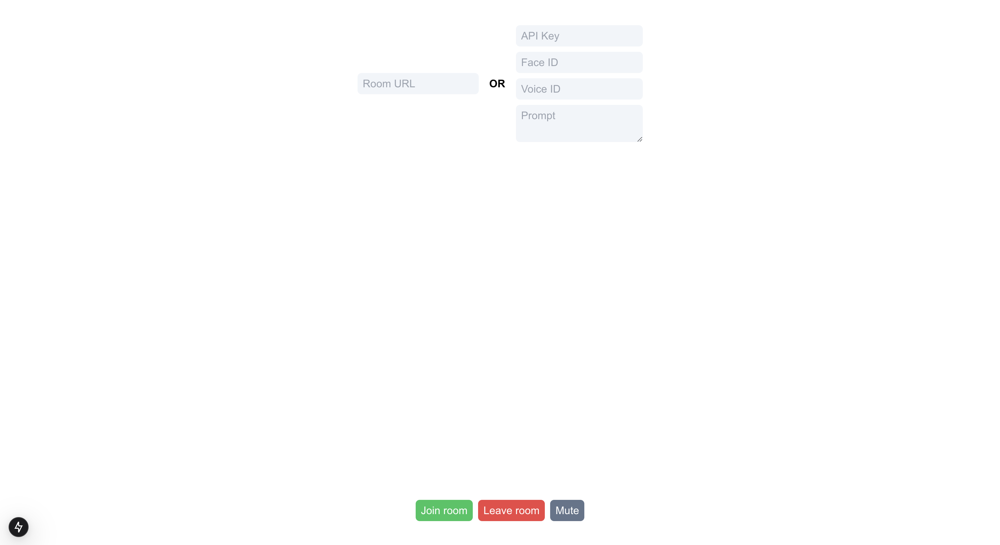

> [!WARNING]
> **This repository is archived.** It was built for an earlier version of the Simli API and SDK, and is no longer maintained or guaranteed to work. Some of its code puts API keys in the browser, so don't deploy it.
>
> Start from a current starter instead: [all Simli starters](https://docs.simli.com/api-reference/samples/all-samples) (LiveKit Agents, Pipecat, ElevenLabs, OpenAI Realtime, Vapi). Or give your coding agent Simli in one command: `npx skills add simliai/skills`.


# Simli End 2 end sample repo




# Setup

Clone the repository
```
git clone https://github.com/simliai/E2E_example
```

change directory to the repository
```
cd E2E_example
```

Install dependencies
```
npm install --force
```

Run the example
```
npm run dev
```

# Run

Insert the API key, Face ID, voice ID and the prompt and click join room
